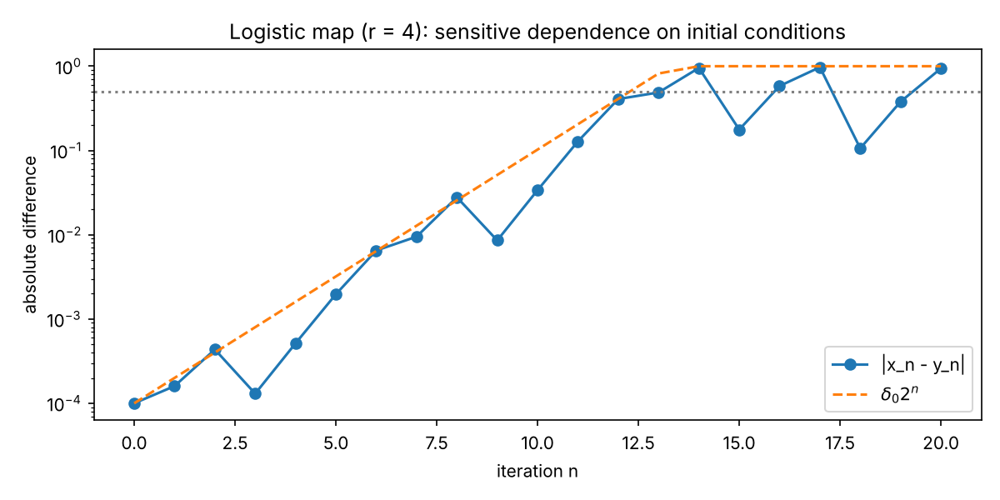
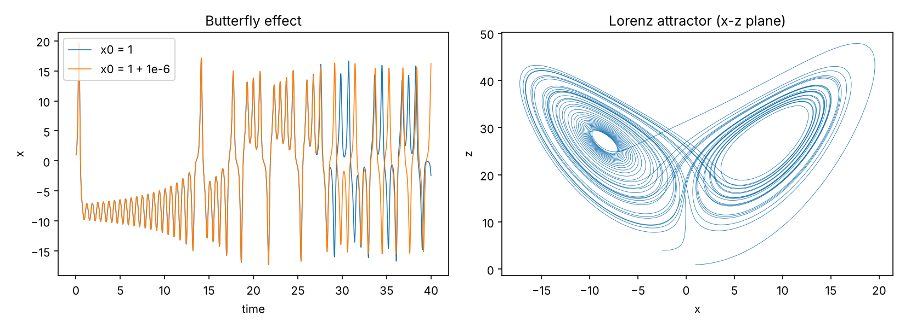
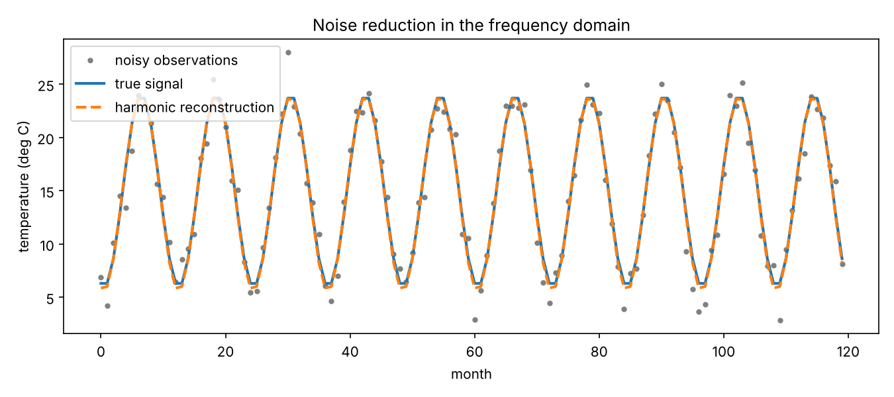

# Kaos Teorisi, Kelebek Etkisi, Fraktallar ve Noise — Atmosfer Bilimleri ve ML Perspektifi

**Cansu Yamanlar** · İTÜ MTO 311E Data Analysis · Kasım 2026

## 1. Giriş: Hocanın notları ne söylüyor?

Hocanın tek cümlelik mesajı şu: **atmosfer gibi doğrusal olmayan (nonlinear) sistemlerde küçük bir hata ya da gürültü (noise), iteratif adımlarda büyür; bu yüzden hem veriden gürültüyü ayıklamalı hem de tek bir tahmine değil, olasılıklara bakmalıyız.**

Notlardaki maddelerin açık hâli:

| Nottaki ifade                                                                                        | Ne demek                                                                                                            | Bu raporda |
|------------------------------------------------------------------------------------------------------|---------------------------------------------------------------------------------------------------------------------|------------|
| "Modelin patlaması, noise'ın artması, model kaldıramaz; iteratif adımlarda"                          | Model her adımda bir önceki çıktısını girdi olarak kullanır; hata her adımda çarpılarak büyür (noise amplification) | Bölüm 3, 4 |
| "Noise / noise reduction → Harmonik analizde"                                                        | Gürültü frekans uzayında ayıklanabilir (Fourier/harmonik analiz, smoothing)                                         | Bölüm 4    |
| "Sensitive dependence on initial conditions (Chaos theory)"                                          | Başlangıç koşulundaki minicik fark zamanla dev bir farka dönüşür                                                    | Bölüm 2, 3 |
| "Fractal geometry → zaman serisi, borsa hareketi, hava"                                              | Doğadaki düzensiz şekillerin ve serilerin her ölçekte benzer görünmesi                                              | Bölüm 5    |
| "Kaos teorisi: film, Edward Lorenz"                                                                  | Kaos teorisinin babası Lorenz ve onu anlatan belgesel                                                               | Bölüm 2    |
| "Noise önemli sinyallerde daima vardır… elektromanyetik… frekans ortamında gürültüler ayıklanabilir" | Her ölçümde gürültü vardır; sinyal ile gürültü farklı frekanslarda yaşadığı için ayrılabilir                        | Bölüm 4    |

Akış: önce kaosun ne olduğunu, sonra neden başlangıç koşullarına bağlı olduğunu matematikle gösteriyoruz. Ardından noise, fraktallar, atmosfer/sürdürülebilirlik uygulamaları ve makine öğrenmesi (ML) bağlantısı geliyor.

## 2. Kaos nedir? Lorenz'in hikayesi

**Kaos = deterministik ama öngörülemez davranış.** Sistemi yöneten denklemler tam olarak bellidir, içinde zar atma (rastgelelik) yoktur. Yine de uzun vadeli geleceği pratikte hesaplanamaz.

### Hikaye: 0.506127 yerine 0.506

1961'de MIT'de meteorolog Edward Lorenz, 12 değişkenli basit bir hava modeli çalıştırıyordu. Bir simülasyonu tekrar görmek için yarıdan başlattı ve ara değeri çıktıdan elle girdi. Bilgisayar 0.506127 tutarken çıktıda 0.506 yazıyordu. Aradaki fark binde birden küçüktü, yani bir ölçüm hatası kadar.

Kahve içip döndüğünde iki simülasyonun birkaç "ay" sonra tamamen farklı hava ürettiğini gördü. Bilgisayar bozuk değildi: **sistem, başlangıçtaki minicik farka aşırı duyarlıydı.** Bu, hocanın notundaki *sensitive dependence on initial conditions* kavramıdır.

### Lorenz (1963) denklemleri

Lorenz daha sonra modeli, alttan ısıtılan bir sıvı tabakasındaki konveksiyonu (Rayleigh–Bénard konveksiyonu) tarif eden 3 denkleme indirdi:

$$
\frac{dx}{dt} = \sigma (y - x), \qquad \frac{dy}{dt} = x(\rho - z) - y, \qquad \frac{dz}{dt} = xy - \beta z
$$

Klasik değerler σ = 10, ρ = 28, β = 8/3 şeklindedir. Değişkenlerin ve parametrelerin fiziksel anlamı:

| Sembol              | Fiziksel anlamı                                                  |
|---------------------|------------------------------------------------------------------|
| x                   | Konvektif dolaşımın şiddeti (hava hücresinin dönme hızı ve yönü) |
| y                   | Yükselen ve alçalan kollar arasındaki yatay sıcaklık farkı       |
| z                   | Dikey sıcaklık profilinin doğrusal profilden sapması             |
| σ (Prandtl sayısı)  | Viskozitenin ısı iletimine oranı                                 |
| ρ (Rayleigh sayısı) | Alttan ısıtmanın şiddeti; ρ ≈ 24.74'ün üstünde kaos başlar       |
| β                   | Konveksiyon hücresinin geometrisi (en/boy oranı)                 |

Kritik nokta **xz ve xy terimleridir: bunlar doğrusal olmayan (nonlinear) terimlerdir.** Doğrusal bir sistemde girdideki hata çıktıya orantılı olarak geçer. Doğrusal olmayan sistemde ise hata kendi kendini çarpar ve üstel olarak büyür.

### Kelebek etkisi ve garip çeker (strange attractor)

Çözüm uzayda çizildiğinde kelebek kanatlarına benzeyen bir şekil çıkar: **Lorenz çekeri (Lorenz attractor).** Yörünge iki kanat arasında düzensizce gidip gelir, kendini asla tekrarlamaz ama kanatların dışına da çıkmaz.

- **Hava (weather)** = yörüngenin şu an hangi kanatta olduğu. Bu, uzun vadede öngörülemez.

- **İklim (climate)** = kanatların şekli, yani istatistik. Bu ise öngörülebilir.

Lorenz 1972'deki konuşmasına "Brezilya'da bir kelebeğin kanat çırpması Teksas'ta bir kasırga başlatır mı?" başlığını verdi. Bu yüzden kavram **kelebek etkisi (butterfly effect)** adıyla bilinir. Kelebek gerçekten kasırga yaratmaz. Fikir şu: gözlemleyemediğimiz küçük ölçekli bir fark, zamanla tahminimizi tamamen değiştirecek kadar büyüyebilir.

### Hocanın bahsettiği film

Notta filmin adı yazılmamış. Lorenz'i anlatan iki bilinen belgesel var, ikisi de bu konuları kapsıyor:

- **BBC – *The Secret Life of Chaos* (2010, sunucu Jim Al-Khalili).** Turing'in desen oluşumu, Lorenz'in hava modeli, Mandelbrot'un fraktalları ve düzensizlikten düzenin doğuşu anlatılır. Hocanın notundaki kaos + fraktal ikilisine en çok uyan bu.

- ***Chaos: A Mathematical Adventure* (2013, Ghys, Leys ve Alvarez).** 9 bölümlük bir animasyon. Lorenz çekerini ve kelebek etkisini görsel olarak çok iyi anlatır.

Hocanın hangisini kastettiğini derste teyit etmekte fayda var.

## 3. Neden başlangıç koşullarına bağlı? Matematik ve fizik

**Cevap: doğrusal olmayan sistemlerde iki yakın başlangıç noktası arasındaki mesafe her adımda bir katsayıyla çarpılır. Bu yüzden hata toplanarak değil, üstel olarak büyür.**

### Adım 1 — En basit kaotik sistem: lojistik harita

Hocanın "iteratif adımlar" dediği şey tam olarak budur. Bir sonraki değer bir öncekinden hesaplanır:

$$
x_{n+1} = r \, x_n \, (1 - x_n), \qquad r = 4
$$

Aynı denklemi iki kez çalıştıralım: biri x₀ = 0.3, diğeri x₀ = 0.3001 ile başlasın. Fark yalnızca 0.0001, yani bir termömetrenin yuvarlama hatası kadar. Aşağıdaki grafikte 10. adımda farkın 0.034'e, 20. adımda 0.94'e çıktığı görülüyor. Bu noktada iki seri artık tamamen ilgisizdir; değerler zaten 0 ile 1 arasında olduğundan hata "doymuş" olur.



Python ile hesaplandı · lojistik harita r = 4, 20 iterasyon

Fark, ilk adımlarda iniş çıkış yapsa da ortalamada her adımda iki katına çıkan teorik çizgiyi izliyor ve 0–1 aralığına ulaşınca doyuyor.

### Adım 2 — Neden çarpılıyor? (Matematik)

Küçük bir hata δₙ için Taylor açılımı şunu verir: δₙ₊₁ ≈ f′(xₙ) · δₙ. Yani her adımda hata, fonksiyonun o noktadaki eğimiyle çarpılır. Bu eğimlerin ortalama logaritmasına **Lyapunov üssü (Lyapunov exponent) λ** denir:

$$
\lambda = \lim_{N\to\infty} \frac{1}{N} \sum_{n=0}^{N-1} \ln \lvert f'(x_n) \rvert, \qquad \delta(t) \approx \delta_0 \, e^{\lambda t}
$$

- **λ \< 0:** Hata söner, sistem kararlıdır (sürtünmeli sarkaç).

- **λ = 0:** Hata sabit kalır (periyodik hareket, örneğin gezegen yörüngesi).

- **λ \> 0:** Hata üstel büyür, yani **kaos.** r = 4 için λ = ln 2 ≈ 0.693'tir: hata ortalamada her adımda iki katına çıkar.

### Adım 3 — Öngörülebilirlik ufku (predictability horizon)

Hata, kabul edilebilir sınır Δ'ya ulaşınca tahmin değersiz olur. Bu süre:

$$
T \approx \frac{1}{\lambda} \ln \frac{\Delta}{\delta_0}
$$

**Önemli sonuç:** Başlangıç hatasını (δ₀) 10 kat azaltmak, tahmin süresine yalnızca ln 10 / λ ekler. Lojistik haritada bu sadece 3.3 adım demektir. Ölçümleri ne kadar iyileştirirseniz iyileştirin, kazanç logaritmik kalır.

### Adım 4 — Atmosferdeki karşılığı (Fizik)

Atmosferde doğrusal olmayan terim, Navier–Stokes denklemindeki **adveksiyon terimi (u·∇)u**'dur. Rüzgar kendi kendini taşır. Bu terim hava parsellerini **gerer ve katlar (stretching and folding)**: yakın iki parsel önce birbirinden uzaklaşır, sonra sınırlı bir alana geri katlanır. Bu yüzden hata sınırsız büyümez, ama bilgi kaybolur.

Sayılarla atmosfer:

- Sinoptik ölçekte (cepheler, alçak basınç sistemleri) hatanın iki katına çıkma süresi (error doubling time) bugünkü modellerde yaklaşık 1.5–2 gündür.

- Konvektif ölçekte (gök gürültülü fırtına) bu süre saatler mertebesindedir.

- Küçük ölçekli hatalar zamanla büyük ölçeklere taşınır (upscale error growth, Lorenz 1969). Bu yüzden deterministik hava tahmininin pratik sınırı yaklaşık 10 gün, teorik üst sınırı ise yaklaşık 2 haftadır.

**Somut örnek:** Bugün İstanbul üzerindeki sıcaklık analizinde 0.5 °C hata olduğunu ve hatanın 2 günde ikiye katlandığını varsayalım. Hata 2. gün 1 °C, 4. gün 2 °C, 6. gün 4 °C, 8. gün 8 °C olur. 8 °C'lik hata, iklimsel ortalamayı söylemekten farksızdır: tahmin artık bilgi taşımaz. Bu basitleştirilmiş bir hesaptır; gerçekte hata belli bir seviyede doyar.

## 4. Noise nedir? Hata ile noise aynı şey mi?

**Noise (gürültü), ölçtüğümüz değerin içindeki, asıl ilgilendiğimiz fiziksel sinyale ait olmayan rastgele kısımdır.** Her ölçüm şu şekilde yazılabilir:

$$
x_t = s_t + b + \varepsilon_t \qquad \text{(observation = true signal + bias + random noise)}
$$

### Hata, bias ve noise ayrımı

| Terim                                    | Tanım                                                | Atmosfer örneği                                                 | Nasıl giderilir                                |
|------------------------------------------|------------------------------------------------------|-----------------------------------------------------------------|------------------------------------------------|
| Hata (error)                             | Gözlem − gerçek değer; toplam fark                   | Termömetre 21.7 °C diyor, gerçek 21.0 °C                        | Bileşenlerine ayırarak                         |
| Bias (sistematik hata)                   | Hep aynı yönde kayma; ortalaması sıfır değil         | Güneşe maruz kalan sensör hep +0.5 °C fazla ölçer               | Kalibrasyon, homojenlik testi, bias correction |
| Noise (rastgele hata, ε)                 | Ortalaması sıfır, öngörülemeyen dalgalanma           | Sensör çözünürlüğü, elektronik gürültü, elektromanyetik parazit | Ortalama alma, smoothing, filtreleme           |
| Temsil hatası (representativeness error) | Nokta ölçümünün model grid kutusunu temsil edememesi | Bir istasyon, 9 km'lik model hücresinin ortalaması değildir     | Veri asimilasyonunda hata kovaryansı ile       |

Yani **noise, hatanın rastgele olan parçasıdır.** Bias'ı bir kere bulursanız çıkarırsınız. Noise'u ise tek bir ölçümde ayıklayamazsınız, ancak istatistikle (çok ölçüm, frekans analizi) bastırabilirsiniz.

**Kaos noise değildir.** Kaotik bir seri rastgele *görünür* ama deterministiktir. Noise gerçekten rastgeledir. Sınavda bu ayırt edici nokta sorulabilir.

### Hocanın örneği: radyo ve elektromanyetik parazit

Radyo dinlerken şarkı sinyaldir, cızırtı ise noise'dur. Otomatik meteoroloji istasyonunda da durum aynıdır. Sensör kablosu yakındaki bir elektrik hattından veya telsizden elektromanyetik parazit alır ve verinin üzerine hızlı, düzensiz sıçramalar ekler. Hocanın "noise önemli sinyallerde daima vardır" demesinin anlamı budur: sıfır gürültülü ölçüm yoktur.

### "Model patlar": iteratif modelde noise neden büyür?

Sayısal hava tahmin modeli bir zaman adımının çıktısını bir sonrakinin girdisi yapar. Başlangıç verisindeki noise, Bölüm 3'teki gibi her adımda e^λ ile çarpılır. Bu noise'un ikinci bir zararı daha vardır: grid'in çözemeyeceği kısa dalga boylu gürültü sayısal olarak kararlı olmayan (numerically unstable) modları tetikleyebilir. Bu durumda model gerçekten "patlar" (blow-up) ve değerler sonsuza gider. Hocanın "model kaldıramaz" dediği şey budur. Bu yüzden modeller başlangıç verisini dengeler (initialization) ve sayısal difuzyon ya da filtrelerle kısa dalgaları söndürür.

### Noise reduction: frekans uzayında ayıklama (harmonik analiz)

Hocanın son notu, "frekans ortamında gürültüler ayıklanabilir", derste gördüğünüz **Harmonic Analysis** ile doğrudan bağlantılıdır. Mantık şudur:

1.  Seriyi harmoniklerin toplamı olarak yazın: x_t = x̄ + Σ \[a_k cos(2πkt/N) + b_k sin(2πkt/N)\].

2.  Her harmoniğin taşıdığı varyansı hesaplayın: C_k²/2, burada C_k² = a_k² + b_k².

3.  **Fiziksel sinyal birkaç düşük frekansta toplanır.** Örneğin aylık sıcaklıkta 1. harmonik (yıllık döngü) toplam varyansın %90'ından fazlasını açıklayabilir.

4.  **Beyaz gürültü (white noise) ise tüm frekanslara eşit dağılır.** Yüksek frekanslı harmoniklerin çoğu noise'dur.

5.  İlk birkaç harmoniği tutup gerisini atın ve seriyi yeniden oluşturun. Sonuç, gürültüsü azaltılmış sinyaldir.

Derste gördüğünüz **hareketli ortalama (moving average), binom/Gauss smoothing ve LOWESS** de aynı işi zaman uzayında yapar. Bunlar alçak geçiren filtrelerdir (low-pass filter): yavaş değişen sinyali tutar, hızlı titreşen noise'u bastırır. Başarı **sinyal/gürültü oranı (signal-to-noise ratio, SNR)** ile ölçülür: SNR = Var(sinyal) / Var(noise).

## 5. Fraktal geometri: hava, zaman serisi ve borsa

**Fraktal, büyüttükçe kendine benzeyen (self-similar) ve boyutu tam sayı olmayan bir şekildir.** Öklid geometrisi doğru, daire ve küp gibi pürüzsüz şekilleri anlatır. Doğadaki bulut, kıyı şeridi, şimşek ve dağ sırası ise pürüzlüdür. Mandelbrot bunları anlatmak için fraktal geometriyi kurdu. Hocanın "olaylara bakışta önemli, şekil geometrisi" notu buna işaret eder.

### Fraktal boyut nasıl hesaplanır?

Bir şekli ε boyutlu kutularla örttüğümüzü ve N(ε) kutu gerektiğini düşünelim. Kutu sayma boyutu (box-counting dimension) şöyle tanımlanır:

$$
D = \lim_{\varepsilon \to 0} \frac{\log N(\varepsilon)}{\log (1/\varepsilon)}
$$

- **Doğru:** D = 1. **Düzlem:** D = 2.

- **Koch eğrisi:** Her adımda bir parça 3'e bölünür ve yerine 4 parça konur, bu yüzden D = log 4 / log 3 ≈ 1.26. Çizgiden fazla, düzlemden azdır.

- **Kıyı paradoksu:** Mandelbrot (1967), Britanya kıyısının uzunluğunun cetvel kısaldıkça sürekli arttığını gösterdi. Batı kıyısı için D ≈ 1.25 bulundu.

- **Lorenz çekeri:** D ≈ 2.06. Bölüm 2'deki kelebek şeklinin kendisi bir fraktaldır. Bu yüzden kaos ve fraktal aynı madalyonun iki yüzüdür: kaos dinamiği, fraktal ise o dinamiğin geometrisini anlatır.

### Atmosferdeki fraktallar

- **Bulutlar:** Lovejoy (1982) uydu ve radar görüntülerinde bulut ve yağış alanlarının çevre–alan ilişkisinin, birkaç kilometreden binlerce kilometreye kadar aynı fraktal boyutla (D ≈ 1.35) tarif edildiğini gösterdi. Yani bir bulut fotoğrafına bakarak ölçeği tahmin edemezsiniz.

- **Türbülans:** Richardson'ın 1922 tarihli ünlü dizesi şöyledir: "Big whirls have little whirls that feed on their velocity, and little whirls have lesser whirls and so on to viscosity." Büyük girdaplar enerjiyi küçüklere aktarır (enerji kaskadı). Kolmogorov (1941) bunun enerji spektrumunun E(k) ∝ k^(−5/3) olduğunu gösterdi. Bu, ölçekten bağımsız yani fraktal bir yapıdır.

- **Yağış ve şimşek:** Yağış alanları ve şimşek kanalları da fraktal ve çoklu-fraktal (multifractal) davranış gösterir.

### Zaman serisinde fraktal: Hurst üssü

Zaman serisi de fraktal olabilir: bir sıcaklık ya da nehir debisi serisini 10 yıllık veya 100 yıllık pencerede çizdiğinizde benzer düzensizlik görürsünüz. Bunu **Hurst üssü H** ölçer:

- **H = 0.5:** Rastgele yürüyüş, hafıza yok.

- **H \> 0.5:** Kalıcılık (persistence). Kurak yılı yine kurak yıl izleme eğilimindedir, yani uzun süreli hafıza (long-range dependence) vardır.

- **H \< 0.5:** Ters dönme eğilimi (anti-persistence).

- Serinin grafiğinin fraktal boyutu D = 2 − H'dir.

Hurst, H ≈ 0.7 değerini Nil nehrinin yıllık taşkın kayıtlarında baraj tasarımı çalışırken buldu. **Bu, trend analizi için kritik bir uyarıdır:** kalıcılığı olan bir seride Mann–Kendall gibi testler, gerçekte olmayan bir trendi anlamlı bulabilir. Derste gördüğünüz otokorelasyon ve homojenlik konuları bu yüzden önemlidir.

### Borsa ile ilgisi

Mandelbrot 1963'te pamuk fiyatlarını inceledi. Fiyat değişimlerinin normal dağılıma uymadığını gördü: büyük çöküşler beklenenden çok daha sıktı (kalın kuyruklar, fat tails) ve grafik günlük, aylık ve yıllık ölçekte benzer görünüyordu.

|                  | Atmosfer                                                          | Borsa                                   |
|------------------|-------------------------------------------------------------------|-----------------------------------------|
| Ortak yön        | Çok ölçekli, kalın kuyruklu (aşırı olaylar), oynaklık kümelenmesi | Aynı özellikler                         |
| Yöneten yasa     | Fizik (Navier–Stokes, termodinamik); deterministik kaos           | Fizik yasası yok; insan davranışı       |
| Tahminin etkisi  | Tahmin havayı değiştirmez                                         | Tahmin fiyatı değiştirir (refleksivite) |
| Öngörülebilirlik | ~10 gün hava, istatistiksel olarak iklim                          | Çoğunlukla rastgele yürüyüşe yakın      |

Yani hoca borsayı "aynı matematiksel dil kullanılır" anlamında örnek veriyor. Borsada atmosferdeki gibi düşük boyutlu deterministik kaos olduğu ise kanıtlanmamıştır.

## 6. Atmosfer bilimleri ve sürdürülebilirlikte nerede kullanılıyor?

**Kaos teorisinin pratikteki en büyük sonucu şudur: modern meteoroloji ve iklim bilimi tek bir tahmin vermez, olasılık dağılımı verir.**

### 6.1 Ensemble (topluluk) tahmini

Madem başlangıç koşulunu tam bilemiyoruz, aynı modeli biraz farklı başlangıç koşullarıyla çok kez çalıştırırız. ECMWF'nin ensemble sistemi (ENS) 1 kontrol ve 50 bozulmuş (perturbed) üye ile çalışır.

- Üyeler birbirine yakınsa (düşük spread) tahmine güvenilir.

- Üyeler dağılıyorsa (yüksek spread) atmosfer o gün "kaotik" bir bölgededir ve belirsizlik yüksektir.

- "Yarın %70 yağış olasılığı" ifadesi, 51 üyeden yaklaşık 36'sının yağış verdiği anlamına gelir.

- Hocanın "başlangıç koşulları değiştirilir" notu, bu bozulmaları (perturbations) anlatır.

### 6.2 Veri asimilasyonu (data assimilation)

Modelin başlangıç durumu, gürültülü gözlemler ile önceki tahminin (background) en iyi şekilde birleştirilmesiyle elde edilir. Kalman filtresi ve 4D-Var bu yöntemlerin en bilinenleridir. Her bilgi kaynağı kendi noise varyansının tersiyle ağırlıklandırılır: gürültülü gözleme az, güvenilir gözleme çok güvenilir. Bölüm 4'teki noise tanımı burada doğrudan matematiksel bir araç olur.

### 6.3 Hava vs. iklim: Lorenz'in iki tür öngörülebilirliği

|                  | Hava tahmini                      | İklim projeksiyonu                                  |
|------------------|-----------------------------------|-----------------------------------------------------|
| Problem türü     | Başlangıç değer problemi (1. tür) | Sınır değer problemi (2. tür)                       |
| Neyi tahmin eder | Yarın İstanbul'da yağmur var mı?  | 2050'de İstanbul'da sıcak gün sayısı ne olacak?     |
| Belirleyen       | Bugünkü atmosfer durumu           | CO₂ gibi dış zorlamalar (forcing)                   |
| Kaosun rolü      | ~10 günden sonra bilgi biter      | Tek yılın değerini değil, istatistiği tahmin ederiz |

"Hava 10 gün sonrasını bilemiyorsa iklimi nasıl biliyoruz?" sorusunun cevabı budur. İklimde çeker şekli değişir, biz de o şekli tahmin ederiz.

### 6.4 İklimde noise = iç değişkenlik (internal variability)

İklim projeksiyonlarında **sinyal**, insan kaynaklı ısınmadır. **Noise** ise ENSO ve NAO gibi kaotik doğal dalgalanmalardır. Bunları ayırmak için aynı iklim modeli onlarca kez, yalnızca başlangıç koşulu değiştirilerek çalıştırılır (initial-condition large ensembles). CESM Large Ensemble (40 üye) ve MPI Grand Ensemble (100 üye) bunun örnekleridir.

- **Üyelerin ortalaması** zorlanmış sinyali verir.

- **Üyeler arası dağılım** doğal değişkenliği verir.

- **Ortaya çıkış zamanı (time of emergence):** Sinyalin noise'u aştığı yıldır (SNR \> 1 veya 2). Sıcaklıkta tropiklerde erken, orta enlemlerde daha geç ortaya çıkar. Yağış daha gürültülü olduğu için çok daha geç ortaya çıkar.

### 6.5 Sürdürülebilirlik ve iklim riski için bilinmesi gerekenler

1.  **Tek model çalıştırmasıyla karar verilmez.** Bir şehrin sel riskini tek bir iklim modeli simülasyonuyla hesaplamak, kelebek etkisini görmezden gelmektir. Ensemble ve olasılık kullanılır.

2.  **Aşırı olaylar kalın kuyrukludur.** Normal dağılım varsayımı 100 yıllık taşkını hafife alır. Dönüş periyodu (return period) analizinde uygun dağılım (örneğin GEV) seçilmelidir.

3.  **Kalıcılık (Hurst) kuraklık riskini büyütür.** Kurak yıllar kümelenir; su kaynakları ve tarım planlaması bunu hesaba katmalıdır.

4.  **Yenilenebilir enerji tahmini olasılıksaldır.** Rüzgar ve güneş üretim tahminlerinde belirsizlik ileri zamana doğru büyür. Şebeke operatörleri ensemble tahminlerini yedek kapasite planlamasında kullanır.

5.  **Mevsimsel tahmin kaosa rağmen mümkündür.** Okyanus sıcaklığı ve ENSO gibi yavaş değişen sınır koşulları sayesinde, 1–3 ay sonrası için "normalden sıcak olma olasılığı" tahmin edilebilir. Tarım ve erken uyarı sistemleri bunu kullanır.

## 7. Makine öğrenmesi açısından önemi

**ML modelleri de kaos ve noise kurallarına tabidir. Bir yapay zekâ hava modeli kelebek etkisini ortadan kaldıramaz; ancak onunla daha akıllıca başa çıkabilir.**

### 7.1 ML'de noise: modelin ezberlememesi gereken şey

ML'de veri y = f(x) + ε olarak düşünülür. Burada f öğrenilecek fiziksel ilişki, ε ise noise'dur. Beklenen hata üçe ayrılır:

$$
E\big[(y - \hat{y})^2\big] = \text{Bias}^2 + \text{Variance} + \sigma_\varepsilon^2
$$

- **σε² (indirgenemez hata, irreducible error):** Ne kadar iyi model kurarsanız kurun, ölçüm noise'u kadar hata kalır.

- **Aşırı öğrenme (overfitting) = noise'u ezberlemek.** Eğitim hatası sıfıra iner ama yeni veride model başarısız olur. Regularizasyon, dropout ve erken durdurma (early stopping) bu yüzden vardır.

- **Noise bazen faydalıdır:** Eğitim sırasında girdiye bilerek noise eklemek (noise injection), modeli ölçüm hatalarına karşı dayanıklı (robust) yapar.

### 7.2 "Model patlar" sorununun ML versiyonu: rollout

GraphCast (Google DeepMind), Pangu-Weather (Huawei), FourCastNet (NVIDIA) ve ECMWF'nin operasyonel AIFS modeli 6 saatlik adımlarla tahmin yapar. 10 günlük tahmin için model kendi çıktısını 40 kez girdi olarak kullanır (autoregressive rollout). Bu, hocanın "iteratif adımlarda noise artar" notunun birebir karşılığıdır.

- Tek adım için eğitilen model, kendi hatalı çıktısını hiç görmemiştir; hatalar birikir ve tahmin gerçekçilikten kopar.

- **Çözüm:** Çok adımlı rollout ile ince ayar (fine-tuning). Model birkaç adım boyunca kendi çıktısıyla eğitilerek kendi hatasını düzeltmeyi öğrenir.

### 7.3 Kaos neden ML tahminlerini bulanıklaştırır?

Model ortalama kare hata (MSE) ile eğitilirse şu olur: uzun vadede gelecek belirsiz olduğundan, MSE'yi en aza indiren tahmin **tüm olası geleceklerin ortalamasıdır.** Bu ortalama pürüzsüz ve bulanık bir alandır. Sonuç olarak fırtınalar zayıflar ve aşırı olaylar kaybolur; bu, iklim riski için tehlikelidir.

**Çözüm olasılıksal ML'dir.** GenCast (DeepMind, 2024) difüzyon modeliyle bir ensemble üretir. ECMWF'nin AIFS ENS modeli CRPS (Continuous Ranked Probability Score) kayıp fonksiyonuyla eğitilir. Yani ML de meteorolojinin kaosa cevabını benimsedi: tek tahmin yerine dağılım.

### 7.4 Frekans uzayı ve sinir ağları

- **Fourier Neural Operator (FNO)**, FourCastNet'in temelidir. Girdiyi Fourier dönüşümüyle frekans uzayına taşır ve **yalnızca ilk birkaç modu (düşük frekansı) tutar.** Bu, harmonik analizde ilk harmonikleri tutup gerisini atmakla aynı fikirdir.

- **Spektral önyargı (spectral bias):** Sinir ağları önce düşük frekansları öğrenir, yüksek frekanslı ayrıntıyı (ve noise'u) sonra öğrenir. Erken durdurma bu yüzden doğal bir noise filtresi gibi çalışır.

### 7.5 Atmosfer verisiyle ML yaparken best practices

1.  **Rastgele train/test bölmesi yapmayın.** Atmosfer verisi otokorelasyonludur (Hurst \> 0.5). Rastgele bölme, dünkü veriyle bugünü "tahmin ettirerek" bilgi sızıntısına (data leakage) yol açar. Yıllara göre bloklu bölme kullanın.

2.  **Başarıyı Lyapunov zamanı ile ölçün.** Kaotik sistem öğrenen modeller (örneğin Pathak ve ark. 2018, reservoir computing), başarıyı "kaç Lyapunov zamanı (1/λ) boyunca doğru tahmin ettiği" ile raporlar.

3.  **Önce veriyi temizleyin.** Homojenlik testi, bias düzeltmesi ve smoothing ML'den önce gelir. Gürültülü veriyle eğitilen model, noise'u fizik sanar.

4.  **Deterministik metriklere ek olarak olasılıksal metrikler kullanın:** RMSE'nin yanında CRPS ve spread–skill oranı.

## 8. Örnek sınav sorusu ve özet

### Question

The logistic map xₙ₊₁ = 4xₙ(1 − xₙ) is iterated from two initial conditions, x₀ = 0.3000 and y₀ = 0.3001.

\(a\) Compute x₁, x₂, x₃, y₁, y₂, y₃ and the absolute differences \|xₙ − yₙ\|. (b) The Lyapunov exponent of this map is λ = ln 2. Estimate the number of iterations after which the difference reaches 0.5. (c) Explain the result in terms of sensitive dependence on initial conditions and noise.

### Solution

**(a)** x₁ = 4(0.3)(0.7) = 0.840000 ve y₁ = 4(0.3001)(0.6999) = 0.840160.

| n   | xₙ       | yₙ       | \|xₙ − yₙ\| |
|-----|----------|----------|-------------|
| 0   | 0.300000 | 0.300100 | 0.000100    |
| 1   | 0.840000 | 0.840160 | 0.000160    |
| 2   | 0.537600 | 0.537165 | 0.000435    |
| 3   | 0.994345 | 0.994475 | 0.000130    |

Fark tek düze artmıyor; 3. adımda azalıyor, çünkü x ≈ 1 civarında eğim \|f′(x)\| = \|4 − 8x\| küçüktür. İlk adımlarda büyüme ancak ortalamada üsteldir.

**(b)** δ₀ = 0.0001, Δ = 0.5 ve λ = ln 2 ≈ 0.693 için:

$$
T \approx \frac{1}{\lambda}\ln\frac{\Delta}{\delta_0} = \frac{\ln(0.5/0.0001)}{\ln 2} = \frac{\ln 5000}{0.693} = \frac{8.517}{0.693} \approx 12.3 \text{ iterations}
$$

Sayısal kontrol: fark 12. adımda 0.408, 13. adımda 0.488, 14. adımda 0.954 olur. Yani 0.5 eşiği 13–14. adımda aşılır ve tahmin, ortalamaya dayalı kestirimle uyumludur.

**(c)** 0.0001'lik bir başlangıç farkı, yani bir ölçüm noise'u, yaklaşık 13 iterasyonda 0–1 aralığının yarısı kadar bir farka dönüşür. Sistem deterministiktir ama λ \> 0 olduğu için kaotiktir. Başlangıç hatasını 10 kat azaltmak T'ye yalnızca ln 10 / ln 2 ≈ 3.3 iterasyon ekler. Bu yüzden tek tahmin yerine ensemble kullanılır.

### Tek sayfalık özet

| Kavram                           | Bir cümlede                                   | Atmosferdeki karşılığı                                    | ML karşılığı                             |
|----------------------------------|-----------------------------------------------|-----------------------------------------------------------|------------------------------------------|
| Kaos                             | Deterministik ama öngörülemez                 | Hava ~10 günden öteye tahmin edilemez                     | Rollout'ta hata birikimi                 |
| Başlangıç koşullarına hassasiyet | λ \> 0 ise hata e^(λt) ile büyür              | Ensemble tahmini, veri asimilasyonu                       | Olasılıksal modeller (GenCast, AIFS ENS) |
| Fraktal                          | Ölçekten bağımsız, kendine benzer yapı        | Bulutlar, türbülans, Hurst kalıcılığı                     | Bloklu train/test bölmesi                |
| Noise                            | Hatanın rastgele, ortalaması sıfır olan kısmı | Sensör ve elektromanyetik parazit; iklimde iç değişkenlik | Overfitting, indirgenemez hata           |
| Noise reduction                  | Sinyali düşük frekansta tut, gerisini at      | Harmonik analiz, MA, LOWESS                               | Fourier Neural Operator, erken durdurma  |

### Kod ve grafikler

`chaos_noise_demo.py` bu rapordaki üç fikri sayısal olarak gösterir. Çalıştırmak için:

```bash
pip install -r requirements.txt
python chaos_noise_demo.py
```

| Bölüm | Ekranda çıkan sonuç | Kaydedilen grafik |
| --- | --- | --- |
| Lojistik harita | Adım adım fark tablosu; λ = 0.6932 (teori ln 2); T ≈ 12.3 adım | `figures/logistic_error_growth.png` |
| Lorenz sistemi | 1e-6 farkla başlayan iki çözüm t ≈ 25'te ayrışır | `figures/lorenz_butterfly.png` |
| Harmonik gürültü temizleme | Yıllık harmonik varyansın %94.5'ini açıklar; SNR 16.6 → 1154 | `figures/harmonic_denoising.png` |




